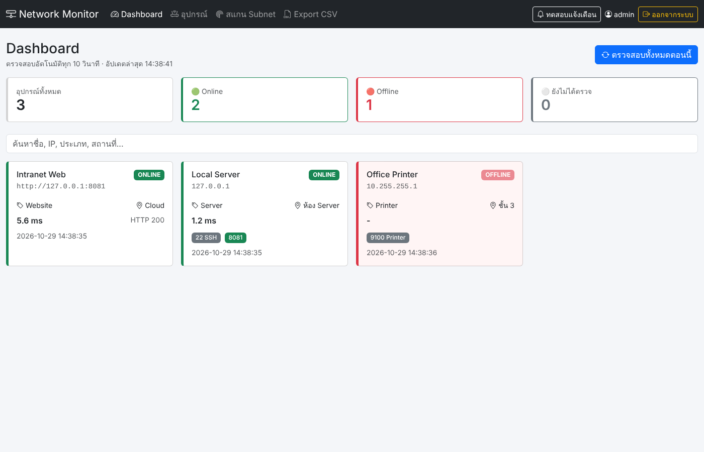
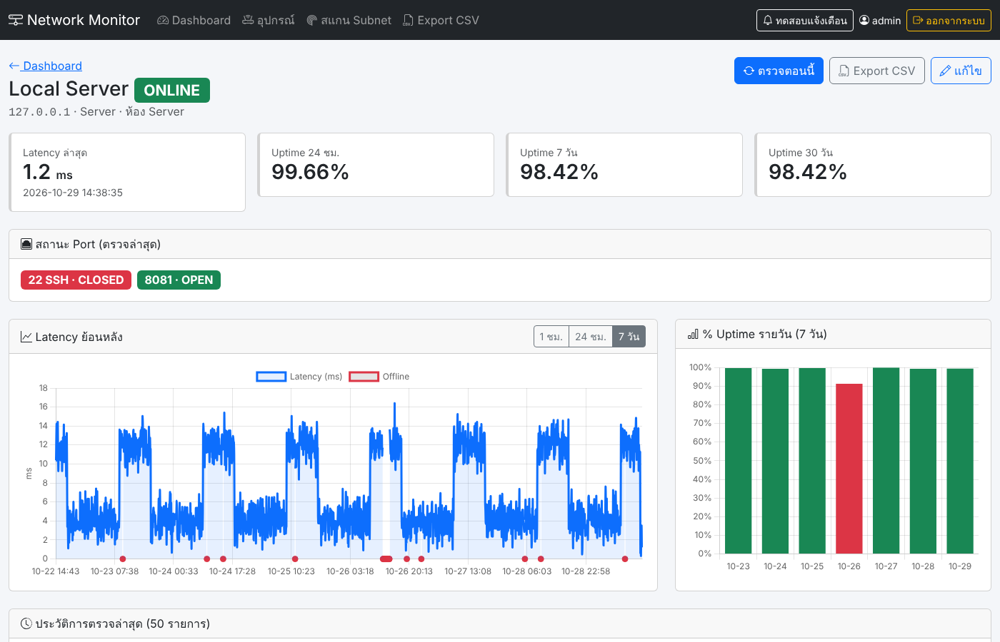
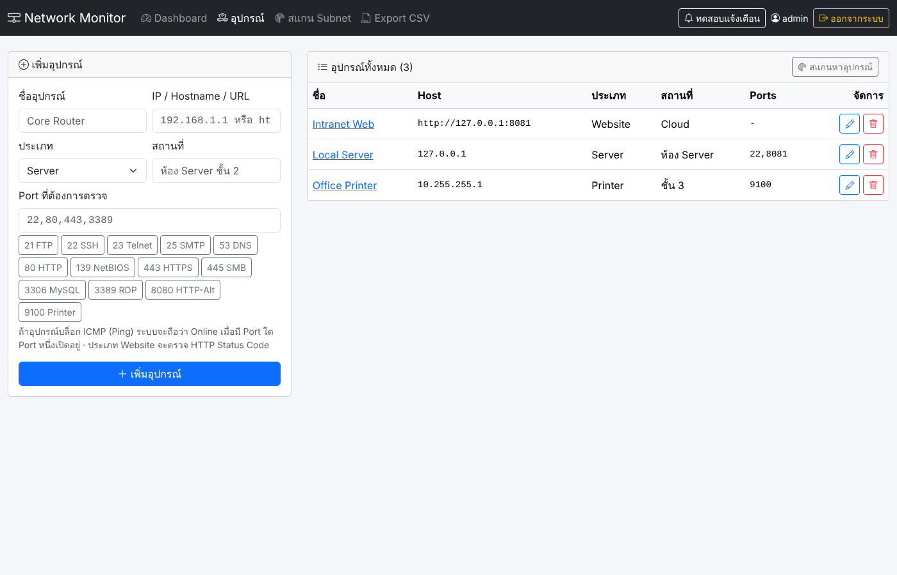

# 🌐 Network Monitoring Dashboard

ระบบเว็บสำหรับตรวจสอบสถานะอุปกรณ์และบริการในเครือข่ายแบบ Real-time พร้อมเก็บประวัติ วิเคราะห์ Uptime และแจ้งเตือนเมื่ออุปกรณ์ล่ม — ให้ทีม IT รู้ปัญหาก่อนผู้ใช้โทรมาแจ้ง



## ✨ ฟีเจอร์

### ฟีเจอร์หลัก
- [x] เพิ่ม / แก้ไข / ลบอุปกรณ์ (ชื่อ, IP Address / Hostname / URL, ประเภท, สถานที่, Port)
- [x] Ping อุปกรณ์อัตโนมัติทุก 60 วินาที (ปรับได้ด้วย `CHECK_INTERVAL_SECONDS`)
- [x] แสดงสถานะ 🟢 Online / 🔴 Offline และค่า Latency (ms) — Dashboard รีเฟรชเองทุก 15 วินาที
- [x] ตรวจสอบ Port สำคัญ เช่น 22 (SSH), 80 (HTTP), 443 (HTTPS), 3389 (RDP)
- [x] บันทึกผลการตรวจทุกครั้งลงฐานข้อมูล SQLite
- [x] กราฟ Latency ย้อนหลัง (1 ชม. / 24 ชม. / 7 วัน) และ % Uptime รายวัน / 24 ชม. / 7 วัน / 30 วัน

### ฟีเจอร์เสริม
- [x] แจ้งเตือนผ่าน Discord Webhook และ/หรือ Telegram Bot เมื่ออุปกรณ์ Offline / กลับมา Online (แจ้งเฉพาะตอนสถานะเปลี่ยน ไม่สแปม)
- [x] สแกนหาอุปกรณ์ใน Subnet (เช่น `192.168.1.0/24`) แล้วเลือกเพิ่มเข้าระบบได้ทันที
- [x] ตรวจสอบเว็บไซต์ (HTTP Status Code, เวลาตอบสนอง)
- [x] Export Log เป็น CSV (ทั้งหมด หรือรายอุปกรณ์ `/export.csv?device_id=1&days=7`)
- [x] ระบบ Login สำหรับผู้ดูแล (รหัสผ่านเก็บแบบ hash, มี CSRF protection)
- [x] ลบ Log เก่าอัตโนมัติ (`LOG_RETENTION_DAYS`)

> **อุปกรณ์ที่บล็อก ICMP:** หลายเครื่อง (เช่น Windows Server ที่เปิด Firewall) ไม่ตอบ Ping ทั้งที่ยังทำงาน ระบบจึงถือว่าอุปกรณ์ Online ถ้ามี Port ที่กำหนดไว้เปิดอยู่อย่างน้อย 1 Port และใช้เวลา TCP connect เป็นค่า Latency แทน

## 📸 ภาพหน้าจอ

| รายละเอียดอุปกรณ์ + กราฟ | จัดการอุปกรณ์ |
|---|---|
|  |  |

*(ภาพหน้าจอใช้ข้อมูลตัวอย่างสำหรับสาธิต)*

## 🛠 เทคโนโลยีที่ใช้

| ส่วน | เทคโนโลยี |
|------|-----------|
| Backend | Python, Flask |
| ฐานข้อมูล | SQLite |
| ตรวจสอบเครือข่าย | `subprocess` (ping), `socket` (port check), `ipaddress`, `requests` (HTTP) |
| งานตั้งเวลา | APScheduler |
| Frontend | HTML, CSS, JavaScript, Bootstrap 5 |
| กราฟ | Chart.js |
| แจ้งเตือน | Discord Webhook / Telegram Bot API |
| ทดสอบ | pytest |

## 🚀 วิธีติดตั้ง

ต้องใช้ Python 3.10 ขึ้นไป

```bash
git clone https://github.com/PeeranutMekchay/Network-Monitoring-Dashboard.git
cd Network-Monitoring-Dashboard
python -m venv .venv
source .venv/bin/activate        # Windows: .venv\Scripts\activate
pip install -r requirements.txt
cp .env.example .env             # Windows: copy .env.example .env
```

แก้ไข `.env` อย่างน้อย `SECRET_KEY` และ `ADMIN_PASSWORD` แล้วรัน:

```bash
python app.py
```

เปิด <http://127.0.0.1:5000> แล้วเข้าสู่ระบบด้วย `ADMIN_USERNAME` / `ADMIN_PASSWORD` (บัญชีถูกสร้างตอนรันครั้งแรก)
ถ้าต้องการให้เครื่องอื่นในเครือข่ายเข้าได้ ตั้ง `FLASK_HOST=0.0.0.0`

### ตั้งค่าการแจ้งเตือน

- **Discord:** Server Settings → Integrations → Webhooks → New Webhook → Copy URL แล้วใส่ใน `DISCORD_WEBHOOK_URL`
- **Telegram:** สร้าง Bot กับ [@BotFather](https://t.me/BotFather) เพื่อรับ `TELEGRAM_BOT_TOKEN` แล้วส่งข้อความหา Bot และดู `chat.id` จาก `https://api.telegram.org/bot<TOKEN>/getUpdates` ใส่ใน `TELEGRAM_CHAT_ID`

กดปุ่ม **ทดสอบแจ้งเตือน** บนแถบเมนูเพื่อตรวจว่าตั้งค่าถูกต้อง

### ตัวแปรใน `.env`

| ตัวแปร | ค่าเริ่มต้น | คำอธิบาย |
|---|---|---|
| `SECRET_KEY` | (สุ่มทุกครั้งที่รัน) | ใช้เข้ารหัส session |
| `DATABASE_PATH` | `network_monitor.db` | ไฟล์ SQLite |
| `ADMIN_USERNAME` / `ADMIN_PASSWORD` | `admin` / `admin` | บัญชีผู้ดูแลเริ่มต้น |
| `CHECK_INTERVAL_SECONDS` | `60` | รอบการตรวจอัตโนมัติ |
| `PING_TIMEOUT_SECONDS` / `PORT_TIMEOUT_SECONDS` / `HTTP_TIMEOUT_SECONDS` | `2` / `1.5` / `5` | Timeout ของแต่ละการตรวจ |
| `LOG_RETENTION_DAYS` | `90` | เก็บ Log กี่วัน (`0` = เก็บตลอด) |
| `DISCORD_WEBHOOK_URL` | | Discord Webhook |
| `TELEGRAM_BOT_TOKEN` / `TELEGRAM_CHAT_ID` | | Telegram Bot |

## 🧪 ทดสอบ

```bash
pytest
```

## 📁 โครงสร้างโปรเจค

```
├── app.py              # Flask app: routes, login, API, export CSV
├── monitor.py          # ping / port check / HTTP check / subnet scan
├── scheduler.py        # APScheduler: ตรวจทุกอุปกรณ์ตามรอบ + ส่งแจ้งเตือนเมื่อสถานะเปลี่ยน
├── notifier.py         # Discord Webhook / Telegram Bot
├── database.py         # SQLite schema และ query ต่าง ๆ
├── templates/          # หน้าเว็บ (Jinja2 + Bootstrap)
├── static/css/style.css
├── static/js/          # dashboard.js (auto refresh), charts.js (Chart.js), device_form.js
├── tests/              # pytest
├── requirements.txt
└── .env.example        # ตัวอย่างค่าตั้ง (ห้าม commit .env จริง)
```

## 🗄 โครงสร้างฐานข้อมูล

**devices** — `id`, `name`, `host`, `device_type`, `location`, `ports` (เช่น `22,80,443`), `created_at`

**check_logs** — `id`, `device_id` (FK → devices, ลบตามเมื่อลบอุปกรณ์), `status` (`online`/`offline`), `latency_ms`, `open_ports`, `http_status`, `checked_at`

**users** — `id`, `username`, `password_hash`, `created_at`

## 🔌 JSON API (ต้อง Login)

| Endpoint | คำอธิบาย |
|---|---|
| `GET /api/status` | สถานะล่าสุดของทุกอุปกรณ์ + สรุปจำนวน |
| `GET /api/devices/<id>/latency?hours=24` | Latency ย้อนหลัง |
| `GET /api/devices/<id>/uptime?days=7` | % Uptime รายวัน |
| `GET /export.csv?device_id=<id>&days=<n>` | ดาวน์โหลด Log เป็น CSV |

## 📚 ความรู้ที่ได้

- IP Address, Subnet Mask, CIDR — ใช้ `ipaddress` คำนวณ host ทั้งหมดใน subnet สำหรับการสแกน
- ICMP (Ping) และเหตุที่บางอุปกรณ์ Ping ไม่ได้ทั้งที่ยังทำงาน (Firewall บล็อก ICMP) → จึงตรวจ TCP Port ประกอบ
- TCP Port และบริการที่ใช้ Port มาตรฐาน
- ขั้นตอน Troubleshoot เครือข่าย: เช็กสาย → IP → Gateway → DNS → บริการปลายทาง
- การทำงานแบบตั้งเวลา (APScheduler) การตรวจพร้อมกันหลายเครื่อง (ThreadPoolExecutor) และการเก็บ Log
